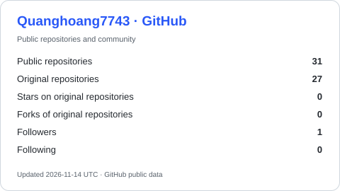
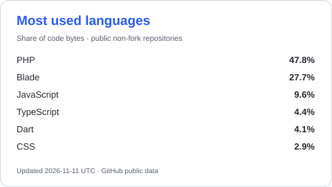
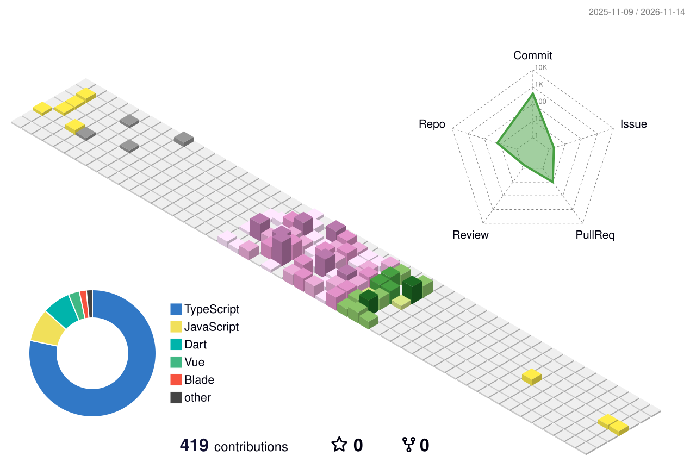

<h1 align="center">Hi, I'm QuangH 👋</h1>

  

  <a href="https://github.com/Quanghoang7743">GitHub</a> ·
  <a href="https://github.com/Quanghoang7743?tab=repositories">Repositories</a> ·
  <a href="#-selected-projects">Selected projects</a>

## 👨‍💻 About me

I build web, mobile and desktop projects, and explore computer vision and data analysis through hands-on work.

- 🌐 Web applications with **React, Next.js and Laravel**.
- 📱 Mobile applications with **Flutter** and **React Native / Expo**.
- 🖥️ Desktop and game projects with **Electron** and **Unity / C#**.
- 👁️ Computer vision experiments with **Python, OpenCV, PyTorch and YOLO**.

## 🧰 Technologies in my projects

### Languages

### Web & backend

### Mobile, desktop & games

### Computer vision & data

## 🚀 Selected projects

| Project | What I work on | Technologies |
| --- | --- | --- |
| [MApp](https://github.com/Quanghoang7743/MApp) | Mobile messaging application | Flutter, Dart, Provider, Pusher |
| [NiMix](https://github.com/Quanghoang7743/NiMix) | Mobile music application | React Native, Expo, TypeScript, Zustand |
| [OpenCV Fruit AI](https://github.com/Quanghoang7743/OpenCV_FRUIT_AI) | Fruit recognition and computer vision | Python, OpenCV, PyTorch, Ultralytics YOLO |
| [EmployeeManager](https://github.com/Quanghoang7743/EmployeeManager) | Employee management interface | React, TypeScript, Vite, Material UI |
| [GameXO](https://github.com/Quanghoang7743/GameXO) | Tic-tac-toe game project | React, TypeScript, Electron, Tailwind CSS |
| [Manager Saff Project](https://github.com/Quanghoang7743/Manager_Saff_Project) | Employee management and real-time messaging | Laravel, React, Reverb, Sanctum |

  <a href="https://github.com/Quanghoang7743?tab=repositories">Explore all my repositories →</a>

## 📊 GitHub activity

  
  

  

### 🐍 Contribution snake

<picture>
  <source media="(prefers-color-scheme: dark)" srcset="https://raw.githubusercontent.com/Quanghoang7743/Quanghoang7743/output/github-contribution-grid-snake-dark.svg" />
  <source media="(prefers-color-scheme: light)" srcset="https://raw.githubusercontent.com/Quanghoang7743/Quanghoang7743/output/github-contribution-grid-snake.svg" />
  
</picture>

### 🌆 Contributions in 3D

<picture>
  <source media="(prefers-color-scheme: dark)" srcset="profile-3d-contrib/profile-night-rainbow.svg" />
  
</picture>

---

Learning by building, one project at a time.

